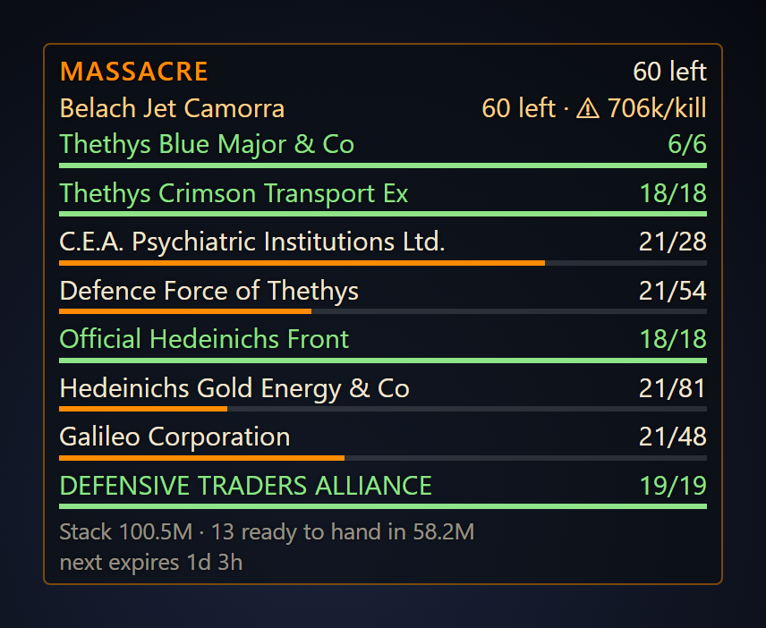
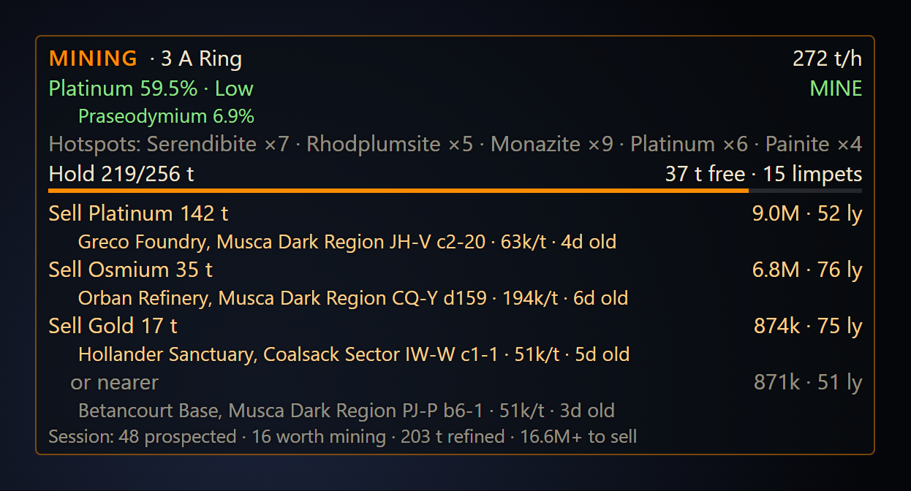

# ED Chat

[](CONTRIBUTING.md#tests)

An AI assistant on top of Elite Dangerous, for Claude Code or OpenAI's Codex.

Ask a question without leaving the game: press a hotkey, type, press Enter, and keep
flying. The reply shows in a corner of the screen. Star system and station names in it
become numbered chips: Ctrl+Alt+1…9 copies one, ready to paste into the galaxy map.

With [ed-mcp](https://github.com/pilotso11/ed-mcp), the assistant knows your game: it
reads your journal, and plans routes, engineering, trade and mission runs. A second, smaller
panel shows what matters for what you are doing right now, from the journal, without
asking the assistant.

## Why

Elite is a game you play with a browser open: Inara, Spansh, EDSM, the wiki. ED Chat puts
one assistant that can use all of them in the game, in a small window that stays out of
the way while you fly.

- **Ask anything, keep flying.** Where to buy a module, which engineer is closest, how
  far to the next stop. Answer approval cards with a key.
- **Know where you are in what you are doing.** Massacre stacks, the bodies worth mapping,
  bio samples, mining and passenger runs, each with its own panel.
- **Your assistant, your login.** ED Chat runs the Claude Code or Codex you already use,
  with your own account and settings. It has no account and no telemetry of its own.

## Pictures

The activity panel, built by ED Chat's own code from a commander's journals:

| | |
| --- | --- |
|  | **Exploration.** The bodies worth scanning and mapping, with their values, and your credits an hour. |
|  | **Exobiology.** Each species' samples and value, the likely species still to find, and whether this planet earns as well as your session. A bookmark (Ctrl+Alt+B) shows the way back to the ship. |
|  | **Massacre.** Each giver's progress, and what each target still pays for each kill left, with ⚠ when it is time to take more missions. |
|  | **Mining.** Whether the rock is worth mining, the hold, and where to sell each load. |
|  | **Passengers and deliveries.** Each stop's passengers or goods and deadlines, with the planned route. |

The panel picks its mode from what you do in the game. [The activity panel](docs/activity-panel.md)
explains each mode.

## Getting started

You need:

- Windows 10 or 11. The overlay is a desktop window, so it does not show in VR.
- Elite Dangerous in **Borderless** or **Windowed** mode (Options → Graphics → Display).
- [Claude Code](https://claude.com/claude-code) or
  [OpenAI's Codex CLI](https://github.com/openai/codex), installed and logged in.
- Recommended: [ed-mcp](https://github.com/pilotso11/ed-mcp), for the game tools. Add it
  once, for your user:

  ```
  claude mcp add ed-mcp -s user -- cmd /c npx -y ed-mcp@latest
  ```

  For Codex and for ed-mcp's settings, see [Using ED Chat](docs/using.md).

Then:

1. **Install ED Chat** from the [Microsoft Store](https://apps.microsoft.com/detail/9PL5FNGQRJX8),
   which signs it and keeps it up to date. Or download `ED Chat Setup <version>.exe` from
   [Releases](https://github.com/pilotso11/ed-chat/releases). That installer is not signed,
   so Windows SmartScreen warns on first run: select **More info → Run anyway**.
2. **Start it.** It asks how the assistant may run tools, then shows its hotkeys. The tray
   icon, an orange chat bubble, has the menu.
3. **Ask.** In the game, press **Ctrl+Alt+Enter**, type, press **Enter**. **Ctrl+\`** shows
   the last reply, then the whole reply, then the chat.

| Key | Action |
| --- | --- |
| Ctrl+Alt+Enter | Open the chat. Enter sends and returns to the game, Esc closes |
| Ctrl+\` | The last reply, then the whole reply, then the chat |
| Ctrl+Alt+1…9 | Copy chip 1…9 |
| Ctrl+Alt+Y / N | Allow / deny a tool the assistant asks to run |
| Ctrl+Alt+P | Show or hide the activity panel |

Type `/new` for a new conversation, `/codex` or `/claude` to switch assistant, and `/quit`
to quit.

## Documentation

- [Using ED Chat](docs/using.md): the overlay's keys and commands, setting up ed-mcp, permissions,
  other model providers and troubleshooting.
- [The activity panel](docs/activity-panel.md): what each mode shows, how, and its keys.
- [Settings](docs/settings.md): every setting in `settings.json`.

## Contributing

Contributions are welcome: bug reports, ideas and pull requests. See
[CONTRIBUTING.md](CONTRIBUTING.md) to build ED Chat, run the tests and send a change.

## Privacy

ED Chat has no telemetry. It passes your messages to the assistant's CLI on
your PC, which sends them to its company: Anthropic for Claude Code, OpenAI for
Codex. See [PRIVACY.md](PRIVACY.md).

Each message also carries a short note of the game state, so the assistant does not
plan from an older turn: your system and nearby body, what the activity panel
shows, and your route. It comes from the same journal data the panel reads.

## License

[MIT](LICENSE).
