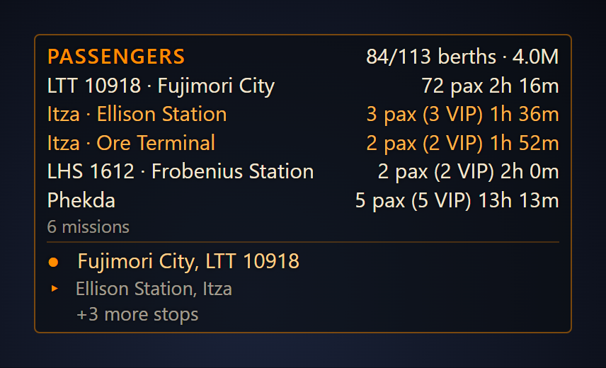

# ED Chat

[](#tests)

A small AI chat window on top of Elite Dangerous, for Claude Code or OpenAI's
Codex. Press a hotkey, ask a question, press Enter, and keep flying. The reply shows in a corner of the
screen. Star system and station names in the reply become numbered chips;
Ctrl+Alt+1…9 or a click copies one, ready to paste into the galaxy map search.

Windows 10 and 11 only. The overlay is a desktop window, so it does not show in
VR.

## Requirements

- Elite Dangerous in **Borderless** or **Windowed** mode (Options → Graphics →
  Display). The overlay cannot show over exclusive fullscreen.
- One of these assistants, installed and logged in. The overlay starts your
  own command and uses your login and settings.
  - [Claude Code](https://claude.com/claude-code) (`claude`), the default.
  - [OpenAI's Codex CLI](https://github.com/openai/codex) (`codex`). Log
    in with `codex login`. Codex runs commands in its Windows sandbox, which
    needs its admin install: see the Codex documentation for
    `[windows] sandbox = "elevated"`.

  With both installed, ED Chat uses Claude Code; type `/codex` in the chat to
  switch. With only Codex installed, ED Chat uses Codex.
- Recommended: [ed-mcp](https://github.com/pilotso11/ed-mcp) for game tools.
  Set it up once, in either assistant: ED Chat finds it and gives the same
  ed-mcp, with its settings, to the other one. For Claude Code, add it for your
  user, not one project. Windows needs `cmd /c` to run `npx`, and `@latest`
  gets each new release:

  ```
  claude mcp add ed-mcp -s user -- cmd /c npx -y ed-mcp@latest
  ```

  Every ed-mcp setting is optional. Add an `-e NAME=value` for each one that you
  use, before the `--`. For example, a sync folder and password let ED Chat,
  Claude Desktop and your other computers share plans and logins:

  ```
  claude mcp add ed-mcp -s user -e ED_MCP_SYNC_DIR=<folder> -e ED_MCP_SYNC_PASSWORD=<password> -- cmd /c npx -y ed-mcp@latest
  ```

  For Codex instead:

  ```
  codex mcp add ed-mcp -- cmd /c npx -y ed-mcp@latest
  ```

  The [ed-mcp README](https://github.com/pilotso11/ed-mcp#readme) lists every
  setting (Inara and EDSM keys, journal folder). The ed-mcp Claude Code plugin
  also works. If you have both and one fails, ED Chat uses the one that works.

## Install

Install ED Chat from the
[Microsoft Store](https://apps.microsoft.com/detail/9PL5FNGQRJX8). The Store
signs the app and keeps it up to date.

Or download `ED Chat Setup <version>.exe` from
[Releases](https://github.com/pilotso11/ed-chat/releases) and run it. This
installer is not code signed, so Windows SmartScreen warns on first run. Select
**More info → Run anyway**.

## Use

| Key | Action |
| --- | --- |
| Ctrl+` | Step: the last reply, then the whole reply, then the chat; a press in the chat closes it |
| Ctrl+Alt+Enter | Open the chat directly. Enter sends and returns to the game. Esc closes. |
| Ctrl+Alt+1…9 | Copy chip 1…9 (top-row digits). A click on a chip also copies it. |
| Ctrl+Alt+Y / N | Allow / deny a tool that the assistant asks to run |
| Ctrl+Alt+A | Allow the tool, and allow it without asking until `/new` |
| Ctrl+Alt+X | Stop the current reply |
| Ctrl+Alt+H | Show or hide this session's history |
| Ctrl+Alt+Shift+Enter | Switch between the full overlay and a small icon |
| Ctrl+Alt+Arrows | Move the overlay around the screen edge |
| Ctrl+Alt+M | Move the overlay to the next monitor |

Type `/new` in the chat to start a new conversation, and `/quit` or `/exit` to quit ED Chat
(as the tray menu's Quit does). Type `/version` to see the versions
of ED Chat, the assistant's CLI, the ed-mcp that ED Chat carries for the activity panel
and the latest ed-mcp on npm, which `npx ed-mcp@latest` runs. Type `/claude` or `/codex`
to switch between Claude Code and OpenAI's Codex; the tray menu's Assistant item does the
same. None of these commands goes to the assistant.

Each assistant keeps its own conversation. Switching back within 12 hours resumes it.
With Codex chosen, your messages and tool results go to OpenAI instead of Anthropic.

When ED Chat starts within 12 hours of your last reply, it resumes that
conversation, and the history (Ctrl+Alt+H) shows its turns. With an ed-mcp that has
the activity tools, the assistant also keeps a short note of what you are doing, for example
scanning bios on a planet or running a massacre stack, and the route that
you are flying. It reads the note when a conversation starts, so it knows
after `/new` or a long break. Set `resumeHours` to change the 12 hours.

At startup the overlay shows its hotkeys for 15 seconds. Click the list to
close it.

The overlay has an orange chat bubble icon in the notification area (system tray).
Windows 11 may hide it under the **^** arrow; drag it to the taskbar to keep it
in view. Click it for a menu: copy a chip, open the chat, start a new
conversation, show the hotkeys, switch icon mode, minimize the overlay to the
tray or restore it, open `settings.json` or the log folder, or quit. While the
overlay is minimized, the hotkeys still work, and the chat and approvals still
show.

In icon mode a reply, an approval or the chat shows over the icon, and the
overlay goes back to the icon when the reply card closes. A click on the icon
switches icon mode off. The icon shows a dot when the last reply has chips or a
notice is waiting.

A long reply shows **▾ more**; click it to see the whole reply. The card does
not close while the pointer is on it.

Ctrl+` steps through what is on screen, one press at a time:

1. The last reply's card. If the overlay is minimized, it comes back too.
2. The whole reply.
3. The chat.
4. Back to rest: the chat, the history and the card close (a reply still
   arriving keeps its card), focus goes back to the game, and
   an overlay that step 1 brought back is minimized again. Closing the chat with
   Esc also minimizes it again.

The step follows what is on screen: after the card fades, the next press starts
again at step 1. With no reply yet, the first press opens the chat. With the
history open (Ctrl+Alt+H), the next press adds the input to it.

The status line shows **● sending** until the reply starts, then
**● receiving**.

Hotkeys work only while the game or the overlay is in front, so they do not
take keys from other apps. Away from the game the overlay shows
`ⓘ hotkeys work while Elite is in front`. While the ship is in danger, the chat
does not open.

While you type in the chat, the overlay leaves typing keys to the chat input,
including AltGr letters. Ctrl+Alt hotkeys such as Ctrl+Alt+X still work there:
use the left Ctrl and Alt keys, because AltGr types the letter.

Outside the chat, Windows sends AltGr as Ctrl+Alt, so in the game's own chat
AltGr+Y, N or A answers a waiting tool request, AltGr+H shows the history and
AltGr+1…9 copies a chip instead of typing a character: € on a UK keyboard, and
@, #, {, [, ] or \ on German, French, Spanish, Nordic and other layouts. With
`hotkeys.scope` set to `"always"` this happens in every app. If that gets in your
way, set those keys in `settings.json`, for example `"copyChip": "Ctrl+Shift+{n}"`.

If the overlay shows `⚠ 2 hotkeys not working`, another app already uses those
keys, or `settings.json` sets the same key for two actions. The tray menu item
**Hotkey problems** lists them. Set other keys in `settings.json`.

The status line shows one message at a time. **+2** after it means two more are
waiting; click it to see them all. A message with a command in it, such as
`run claude update`, copies the command when you click it.

## Activity panel

A second, smaller panel shows what matters for what you are doing. It reads the
game journal directly and never calls Claude. It shows only while the game is in
front.

- **Massacre:** kills left for each target, each giver's progress, and what the
  stack still pays a kill, with ⚠ when it is time to take more missions.
- **Exploration:** the bodies worth scanning and mapping, with their values, and
  your credits an hour.
- **Exobiology:** each species' samples and value, the distance from your last
  sample, and whether this planet earns as well as the rest of your session.
- **Mining:** whether the rock is worth mining, the hold, and where to sell each
  load.
- **Passengers and deliveries:** each stop's passengers or goods and deadlines,
  with the planned route.
- **Route:** the current and next stop of the plan you are following.
- **Bookmarks:** Ctrl+Alt+B marks a spot on a planet, and the panel shows the
  way back.

The mode follows what you do in the game, or what you tell Claude you are doing.
[docs/activity-panel.md](docs/activity-panel.md) has the details of each mode.

| | |
| --- | --- |
|  | **Exploration**, once every body is found. |
|  | **Exobiology**, partway through a planet, with a bookmark back to the ship. |
|  | **Massacre**, partway through a stack. |
|  | **Mining**, on a rich platinum rock. |
|  | **Passengers**, after taking six missions. |

These are real panels, built from a commander's journals.

| Key | Action |
| --- | --- |
| Ctrl+Alt+P | Show or hide the panel |
| Ctrl+Alt+Shift+P | Choose the mode: automatic, then each mode, then off |
| Ctrl+Alt+Home | Move the panel: for 15 seconds the move keys move the panel, not the chat |
| Ctrl+Alt+PageDown / PageUp | Mark the current route stop done / go back one stop, and copy the stop's system |
| Ctrl+Alt+B | Bookmark where you are on a planet |

The panel uses ed-mcp's activity note and plans, and finds ed-mcp's settings by
itself. If it cannot, set `hud.edMcpDataDir`. If Claude Code has no ed-mcp of its
own, ED Chat gives it a copy of the one set up elsewhere, sync password included,
in `%APPDATA%\ed-chat\approval-mcp.json`.

## Permissions

On first run the overlay asks how the assistant should run tools, and saves the
answer as `claude.permissionMode` or `codex.permissionMode` in `settings.json`.
Codex is asked the first time it runs.

- **Ask me** (`default`): the overlay shows each tool that the assistant's own
  rules do not already allow (with Claude Code, your permission rules), and you
  answer it.
- **Auto** (`auto`): with Claude Code, a classifier reviews each action, but it
  runs a command that you ask for explicitly without asking you first. In
  testing, auto mode
  ran `curl … | sh` when asked to, with no prompt. The assistant also acts on
  text it reads, such as tool results, so be careful what you ask it to do. The
  status line shows **AUTO** while auto mode is on.

With Codex, both modes keep its sandbox to ED Chat's data folder: a command or a
file change outside it comes to the approval card. **Auto** lets Codex decide
inside the sandbox; **Ask me** asks before anything Codex does not know to be
safe. Codex never brings MCP tool calls such as ed-mcp to the card. With Claude
Code, your own permission rules decide: in Ask me mode each ed-mcp tool asks
until you allow it, for example with Ctrl+Alt+A until `/new`.

An approval card shows the tool, up to three lines of what it will do, and
`⚠ runs a shell command` for shell tools. It plays a sound (`approval.sound`)
and shows **1 of 3** when more requests wait. Answer with the keys or by
clicking **Allow**, **Deny** or **Always**. **Always** allows that tool without
asking until `/new`. A key pressed in the first moment after the card appears
does not allow, so a key already on its way cannot approve something you have
not read. A bar counts down to `approval.timeoutSeconds`; then the request is
denied and the overlay shows `⛔ denied … no answer`.

To never be asked about ed-mcp tools, add `"mcp__ed-mcp__*"` to
`permissions.allow` in `~/.claude/settings.json`.

## Other model providers

ED Chat starts your own `claude` or `codex` command, so a third-party model
provider that you set up in that assistant also works in ED Chat. Follow your
provider's instructions for Claude Code or Codex, then change these ED Chat
settings:

- **Claude Code**: the provider's settings go in the `env` of
  `~/.claude/settings.json` (`ANTHROPIC_BASE_URL`, `ANTHROPIC_AUTH_TOKEN`, and
  the model names). Set `claude.permissionMode` to `default`. Auto mode needs
  Anthropic's safety check, which does not run through another provider, so in
  auto mode every tool call fails, ed-mcp included. Set `claude.model` to a
  model that the provider has, or keep `sonnet` if the provider maps it to one
  of its models.
- **Codex**: the provider goes in `~/.codex/config.toml`, with
  `wire_api = "responses"` (Codex no longer accepts `"chat"`). Set
  `codex.model` to the provider's model, or to `null` to use the model in
  `config.toml`. The default `gpt-6.1-terra` replaces the model in
  `config.toml`, and the provider does not have it.

This was tested with the z.ai GLM Coding Plan and `glm-5.3`, in both
assistants. A Coding Plan needs a key made for that plan: a standard API key
gets `1113 Insufficient balance`. With Codex, `glm-5.3` asked for approval
before shell commands that OpenAI's models ran without asking.

## Settings

`%APPDATA%\ed-chat\settings.json` holds only the settings you change; every
other setting uses its default. It starts with only a `$schema` line, which
gives editors such as VS Code completion and the default of each setting. Add a
key to override its default, for example
`{ "hotkeys": { "openChat": "Ctrl+Alt+Space" } }`. Every default is listed in
`settings.defaults.json` next to it, which is rewritten at each start; do not
edit that one. Version 0.1.0 wrote every default into `settings.json`, so the
0.1.0 hotkeys stay in effect there: delete the keys you did not change, or the
whole file, to get the current defaults.

Changes apply when you save the file. The file is plain JSON. Settings for
`claude` or `codex` apply after `/new`; the overlay shows, for example,
`ⓘ claude settings apply after /new`.

You can also ask the assistant, for example "what is my bio threshold?" or "only
show bio planets worth 2M or more". It knows where `settings.json` is and reads
`settings.schema.json`, which describes each setting with its default and
limits. It does not change the settings marked player only: `agent`,
`resumeHours`, `claude`, `codex`, `approval`, `safety`, `journalDir` and
`hud.edMcpDataDir`. Change those yourself
from the tray menu, **Open settings**. ED Chat also checks: when one of these
settings changes in the file, by your edit or the assistant's, ED Chat keeps the old
value and asks whether to apply the change. **Undo** puts the old value back in
the file. The other changes in the same save apply at once. ED Chat keeps the
values you last applied in `state.json`, so a change that is still unanswered
when you quit, or that is made while ED Chat is closed, is asked about at the
next start.

| Key | Default | Meaning |
| --- | --- | --- |
| `hotkeys.*` | see above | An Electron accelerator string, or a list of them for more than one key. `copyChip` must contain `{n}` |
| `hotkeys.copyChipNumpad` | `false` | Also copy chips with Ctrl+numpad 1…9. Windows changes Shift+numpad keys, so these use Ctrl only |
| `hotkeys.scope` | `game` | `game`: only while the game or overlay is in front. `always`: everywhere, except keys without a modifier, such as a bare backquote |
| `startup.showKeys` | `true` | Show the hotkeys at startup |
| `strip.lines` | `2` | `1`: status only. `2`: also the first line of the last reply |
| `strip.keepChips` | `true` | Keep the last reply's chips under the status line |
| `strip.startAsIcon` | `false` | Start as the icon on first run (later runs remember the last choice) |
| `card.maxLines` | `4` | Reply lines shown before **▾ more** (2–10) |
| `card.fadeSeconds` | `20` | Seconds before the reply card closes |
| `card.width` | `420` | Width in pixels at font size 14 |
| `chat.lines` | `14` | History lines in the chat |
| `style.fontSize` | `14` | Font size; scales the whole overlay, the icon too |
| `style.backgroundOpacity` | `0.78` | Panel background opacity, from 0 (none) to 1 (solid). Text stays opaque and gets a dark outline as the background gets clearer |
| `position.anchor` | `bottom-left` | `top-left`, `top`, `top-right`, `left`, `right`, `bottom-left`, `bottom`, `bottom-right` |
| `position.offsetX` / `offsetY` | `24` | Pixels from the screen edges |
| `position.display` | `primary` | `primary` or a monitor number (0, 1, …) |
| `safety.blockWhenInDanger` | `true` | Do not open the chat while in danger |
| `approval.timeoutSeconds` | `120` | Deny a request that gets no answer |
| `approval.sound` | `true` | Play a sound when a request arrives |
| `agent` | `claude` | The assistant: `claude` or `codex`. Only you change it, with `/claude`, `/codex` or the tray |
| `resumeHours` | `12` | Resume the assistant's last conversation when ED Chat starts, or switches to it, within this many hours. `0` turns it off. An older `claude.resumeHours` still works |
| `claude.path` | `null` | Path to `claude`; `null` searches `PATH`, then the default install folders |
| `claude.permissionMode` | asked on first run | `auto` or `default` (ask for everything not allowed). Without an answer the code default is `auto` |
| `claude.model` | `sonnet` | The Claude model: `sonnet`, `opus`, `haiku` or a full model name. It replaces the model you chose in Claude Code. `null` uses Claude Code's default |
| `claude.extraArgs` | `[]` | More arguments for `claude` |
| `codex.path` | `null` | Path to `codex`; `null` searches `PATH`, then the default install folders |
| `codex.permissionMode` | asked the first time Codex runs | `auto` (Codex decides inside its sandbox) or `default` (ask before anything not known to be safe) |
| `codex.model` | `gpt-6.1-terra` | The Codex model. It replaces the model in Codex's `config.toml`; if your account does not have it, set another or `null`, which uses `config.toml` |
| `codex.extraArgs` | `[]` | More arguments for `codex app-server` |
| `journalDir` | `null` | The game's journal folder; `null` uses Saved Games |
| `hud.enabled` | `true` | Show the activity panel |
| `hud.position` | `top-right`, 24, 120 | Where the panel sits, like `position` |
| `hud.width` | `380` | Least panel width in pixels at font size 15. The panel grows so long names fit |
| `hud.fontSize` / `hud.backgroundOpacity` | `15` / `0.55` | Panel text size and background |
| `hud.modes.*` | `true` | Turn off `massacre`, `exploration`, `exobiology`, `mining`, `passenger` or `route` |
| `hud.valuableMin` | `500000` | Bodies worth less when mapped are left off the exploration panel. Those with geological signals are counted on one line |
| `hud.bioMin` | `5000000` | Planets whose likely species are worth less than this in total are left off the exploration panel |
| `hud.spansh` | `true` | Look up each system's planets on Spansh when you arrive, and buyers for mined cargo. Only the system's ID, or for buyers the system name and commodity, is sent |
| `hud.mining.targets` | Platinum 20, Painite 25, … | The least percentage of each commodity in a rock that is worth mining; entries change or add to the defaults |
| `hud.mining.useCarrier` | `false` | Sell from your fleet carrier: search for buyers around it |
| `hud.mining.carrierMarkets` | `false` | Include other players' fleet carriers as buyers |
| `hud.mining.sellRadiusLy` / `carrierRadiusLy` | `100` / `500` | How far to search for buyers from the ship, or from the carrier |
| `hud.mining.maxPriceAgeDays` | `7` | Leave out buyers with older Spansh market data |
| `hud.bookmarks` | `true` | Show surface bookmarks (Ctrl+Alt+B) on the body and in the system |
| `hud.edMcpDataDir` | `null` | The ed-mcp sync folder; `null` finds it in ed-mcp's setup |

With the chat open you can also drag the overlay by its status line. It snaps
to the nearest edge or corner when you let go.

A position chosen with the hotkeys or by dragging is saved in `state.json`, until you change
`position` in `settings.json`.

## Troubleshooting

The first line of the overlay shows problems. If ed-mcp is added but does not
start, the overlay shows `⚠ ed-mcp failed to start; run claude mcp list` (or
`codex mcp list`).
Click the message to copy the command. If
the overlay cannot start at all, it shows an error dialog. The log is
`%APPDATA%\ed-chat\logs\overlay.log`. It does not record your messages or
the assistant's replies. When the CLI stops, the log keeps its last error
lines, cut to 160 characters each, and those can quote part of a request. Check
the log before you share it.

Each conversation's messages are also saved in `%APPDATA%\ed-chat\history\`, one
file per conversation. When ED Chat resumes a conversation, it reads the last 200
turns of that file back into the history view and adds new turns to the same
file. You can open or delete the files. If you delete the file of the last
conversation, ED Chat still resumes it, but the history view starts empty.

## Tests

- `npm run check`: typecheck, format check, and the unit tests with coverage. It fails if
  coverage of `src/core` or of the React components drops below the minimums in
  `vitest.config.ts`. The HTML report is in `coverage/`.
- The tests in `test/renderer` render the chat window and the activity panel with React Testing
  Library in jsdom, with a fake `window.overlay` in place of the preload API. They push views in
  as main does, and check what the windows show and what they send back to main.
- `npm run test:e2e`: builds the app, then runs the Playwright tests in `e2e/`. They start
  ED Chat in Electron with a fake Claude CLI and temporary folders, so they do not touch your
  settings, your journal or your Claude login. Its windows do show on screen, over whatever is
  in front, so the tests refuse to run while Elite is running; set `E2E_FORCE=1` to run them
  anyway. `npm run check` does not run them.

CI runs `npm run check`, then the Playwright tests on the app that its installer build made,
and shows the coverage summary on each run. The release workflow attaches `coverage.json`
(from `scripts/coverage-badge.ts`) to each release, and the coverage badge above reads it from
the latest release, so CI commits and publishes nothing for it.

## Releases

Release-please opens a release PR from the commits on `main`. Merge it to tag the
release; the workflow then builds the installer and attaches it.

Release-please acts as a GitHub App that belongs to the repository owner and is
installed on this repository only, with read and write access to Contents, Pull
requests and Issues. Its release PR runs CI, which a PR made with `GITHUB_TOKEN`
does not, and GitHub signs the commits it makes. The release workflow names the
app by its Client ID, and its private key is the repository secret
`RELEASE_APP_KEY`. The key does not expire; to replace it, generate a new one in
the app's settings and set it with `gh secret set RELEASE_APP_KEY < key.pem`.

## Code signing

The files on GitHub Releases are not code signed. The `.exe` is the installer
described under Install. The `.appx` is the package for the Microsoft Store and
is not meant to be installed directly; the Store signs it when it publishes it.
For a signed install, use the
[Microsoft Store](https://apps.microsoft.com/detail/9PL5FNGQRJX8).

## Privacy

ED Chat has no telemetry. It passes your messages to the assistant's CLI on
your PC, which sends them to its company: Anthropic for Claude Code, OpenAI for
Codex. See [PRIVACY.md](PRIVACY.md).

Each message also carries a short note of the game state, so the assistant does not
plan from an older turn: your system and nearby body, what the activity panel
shows, and your route. It comes from the same journal data the panel reads.
