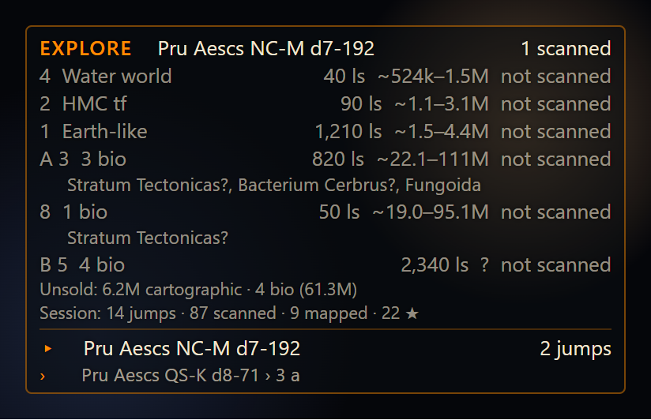
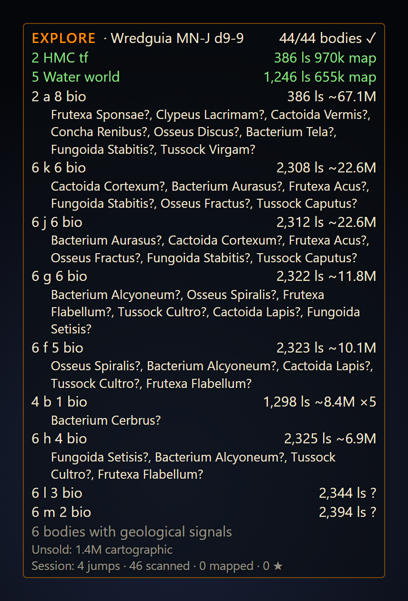
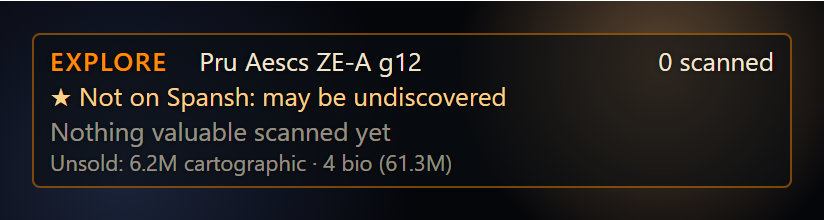
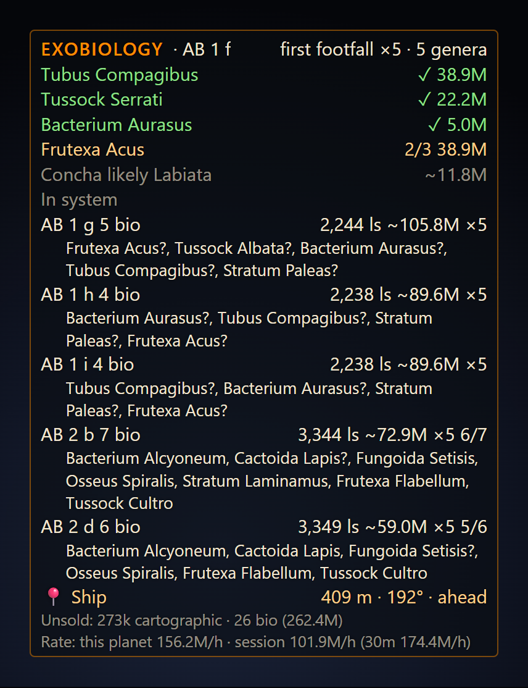

# ED Chat

A small Claude chat window on top of Elite Dangerous. Press a hotkey, ask a
question, press Enter, and keep flying. The reply shows in a corner of the
screen. Star system and station names in the reply become numbered chips;
Ctrl+Shift+1…9 or a click copies one, ready to paste into the galaxy map search.

Windows 10 and 11 only. The overlay is a desktop window, so it does not show in
VR.

## Requirements

- Elite Dangerous in **Borderless** or **Windowed** mode (Options → Graphics →
  Display). The overlay cannot show over exclusive fullscreen.
- [Claude Code](https://claude.com/claude-code), installed and logged in. The
  overlay starts your own `claude` command and uses your login and settings.
- Recommended: [ed-mcp](https://github.com/pilotso11/ed-mcp) for game tools.
  ED Chat uses the ed-mcp that your `claude` already has, with its settings.
  Add it for your user, not one project. Windows needs `cmd /c` to run `npx`,
  and `@latest` gets each new release:

  ```
  claude mcp add ed-mcp -s user -- cmd /c npx -y ed-mcp@latest
  ```

  Every ed-mcp setting is optional. Add an `-e NAME=value` for each one that you
  use, before the `--`. For example, a sync folder and password let ED Chat,
  Claude Desktop and your other computers share plans and logins:

  ```
  claude mcp add ed-mcp -s user -e ED_MCP_SYNC_DIR=<folder> -e ED_MCP_SYNC_PASSWORD=<password> -- cmd /c npx -y ed-mcp@latest
  ```

  The [ed-mcp README](https://github.com/pilotso11/ed-mcp#readme) lists every
  setting (Inara and EDSM keys, journal folder). The ed-mcp Claude Code plugin
  also works. If you have both and one fails, ED Chat uses the one that works.

## Install

Install ED Chat from the
[Microsoft Store](https://apps.microsoft.com/detail/9PL5FNGQRJX8). The Store
signs the app and keeps it up to date.

Or download `ED Chat Setup <version>.exe` from
[Releases](https://github.com/pilotso11/ed-chat/releases) and run it. This
installer is not code signed, so Windows SmartScreen warns on first run. Select
**More info → Run anyway**.

## Use

| Key | Action |
| --- | --- |
| Ctrl+` | Step: the last reply, then the whole reply, then the chat; a press in the chat closes it |
| Ctrl+Alt+C | Open the chat directly. Enter sends and returns to the game. Esc closes. |
| Ctrl+Shift+1…9 | Copy chip 1…9 (top-row digits). A click on a chip also copies it. |
| Ctrl+Shift+Y / N | Allow / deny a tool that Claude asks to run |
| Ctrl+Shift+A | Allow the tool, and allow it without asking until `/new` |
| Ctrl+Alt+X | Stop the current reply |
| Ctrl+Shift+H | Show or hide this session's history |
| Ctrl+Alt+Enter | Switch between the full overlay and a small icon |
| Ctrl+Alt+Arrows | Move the overlay around the screen edge |
| Ctrl+Alt+M | Move the overlay to the next monitor |

Type `/new` in the chat to start a new conversation.

When ED Chat starts within 12 hours of your last reply, it resumes that
conversation, and the history (Ctrl+Shift+H) shows its turns. With an ed-mcp that has
the activity tools, Claude also keeps a short note of what you are doing, for example
scanning bios on a planet or running a massacre stack, and the route that
you are flying. It reads the note when a conversation starts, so it knows
after `/new` or a long break. Set `claude.resumeHours` to change the 12 hours.

At startup the overlay shows its hotkeys for 15 seconds. Click the list to
close it.

The overlay has an orange chat bubble icon in the notification area (system tray).
Windows 11 may hide it under the **^** arrow; drag it to the taskbar to keep it
in view. Click it for a menu: copy a chip, open the chat, start a new
conversation, show the hotkeys, switch icon mode, minimize the overlay to the
tray or restore it, open `settings.json` or the log folder, or quit. While the
overlay is minimized, the hotkeys still work, and the chat and approvals still
show.

In icon mode a reply, an approval or the chat shows over the icon, and the
overlay goes back to the icon when the reply card closes. A click on the icon
switches icon mode off. The icon shows a dot when the last reply has chips or a
notice is waiting.

A long reply shows **▾ more**; click it to see the whole reply. The card does
not close while the pointer is on it.

Ctrl+` steps through what is on screen, one press at a time:

1. The last reply's card. If the overlay is minimized, it comes back too.
2. The whole reply.
3. The chat.
4. Back to rest: the chat, the history and the card close (a reply still
   arriving keeps its card), focus goes back to the game, and
   an overlay that step 1 brought back is minimized again. Closing the chat with
   Esc also minimizes it again.

The step follows what is on screen: after the card fades, the next press starts
again at step 1. With no reply yet, the first press opens the chat. With the
history open (Ctrl+Shift+H), the next press adds the input to it.

The status line shows **● sending** until the reply starts, then
**● receiving**.

Hotkeys work only while the game or the overlay is in front, so they do not
take keys from other apps. Away from the game the overlay shows
`ⓘ hotkeys work while Elite is in front`. While the ship is in danger, the chat
does not open.

While you type in the chat, the overlay leaves typing keys to the chat input,
including AltGr letters. Ctrl+Alt hotkeys such as Ctrl+Alt+X still work there:
use the left Ctrl and Alt keys, because AltGr types the letter.

If the overlay shows `⚠ 2 hotkeys taken by other apps`, another app already
uses those keys. The tray menu item **Hotkey problems** lists them. Set other
keys in `settings.json`.

The status line shows one message at a time. **+2** after it means two more are
waiting; click it to see them all. A message with a command in it, such as
`run claude update`, copies the command when you click it.

## Activity panel

A second, smaller panel shows what matters for what you are doing. It reads the
game journal directly and never calls Claude. It shows only while the game is in
front.

- **Massacre:** each target faction, the kills still needed for the stack, a bar
  for each faction that gave you missions, missions ready to hand in, and the
  next expiry.
- **Exploration:** the discovery scan progress and the bodies worth the time:
  Earth-like, water and ammonia worlds, terraformable planets, bodies with
  biological signals, and other bodies worth `hud.valuableMin` when mapped. Each
  shows its distance, its value and whether it still needs a scan or a map. ★
  marks a first discovery. Bodies worth less with geological signals are only
  counted.
  Earth-like, water and ammonia worlds and terraformables are listed from
  [Spansh](https://spansh.co.uk) as soon as you arrive: grey until you scan them,
  then green. Planets with biological signals are listed the same way, with
  the likely species of each genus (marked ?) and what they are likely worth:
  grey before the scan, plain after, and green once every species is analysed.
  ★ marks a first discovery and ×5 a first-footfall bonus.
  The prediction compares the planet's atmosphere, type, temperature, gravity,
  pressure, volcanism, star and galactic region with where Canonn has recorded
  each species. Planets likely worth less than `hud.bioMin` are left off.
  Before you scan a planet, its value is a range: the low end has no bonus, and
  the high end includes the first-discovery and first-mapped bonuses, or the 5×
  first-footfall bonus for biology. A planet listed on Spansh can still pay these
  bonuses if nobody has handed in its data. After the scan, the game says which
  bonuses apply. A system Spansh does not know gets ★ as a hint, since not
  everyone uploads their scans.
- **Exobiology:** on a body with biological signals, each species with its
  samples (2/3) and value, the genera not started yet, and, while you sample, the
  distance from your last sample against the minimum distance for that genus.
  Genera not started show their likely species. The system's Earth-like,
  water and ammonia worlds, terraformables and other bio planets stay listed
  below.
- **Route:** the current stop of the active ed-mcp plan (with its body or
  station, what it is for and the jumps left on the plotted route), the next
  stop, and how many stops follow. It shows under the other panels too. When you arrive in
  a stop's system, the next stop's system is copied for the galaxy map.

These are mock-ups with made-up systems and values, drawn in the panel's own
style.

| | |
| --- | --- |
|  | **On arrival.** Spansh lists the worlds and bio planets before you honk. They show grey, with value ranges, and the route shows under the panel. |
|  | **After scanning.** Scanned worlds turn green with the game's value. Bio planets stay plain until every species is analysed. ★ marks a first discovery, ×5 a first footfall. |
|  | **A system Spansh does not know.** It may be undiscovered. |
|  | **Sampling.** Each species with its samples and value, the distance from the last sample, the likely species of genera not started, and other worlds in the system. |

The mode changes by itself. Accepting a massacre mission turns on massacre mode
until the stack is handed in. A discovery scan or a detailed scan turns on
exploration, and five jumps with no scan turn it off again. Approaching a body
with biological signals, or taking a sample, turns on exobiology. A jump alone
starts nothing. Telling Claude what you are doing ("I'm doing massacres") sets
the ed-mcp activity note, which the panel follows.

| Key | Action |
| --- | --- |
| Ctrl+Alt+P | Show or hide the panel |
| Ctrl+Alt+Shift+P | Mode: auto, massacre, exploration, exobiology, route, off |
| Ctrl+Alt+Home | Move the panel: for 15 seconds the move keys move the panel, not the chat |
| Ctrl+Alt+PageDown / PageUp | Mark the current route stop done / go back one stop, and copy the stop's system |

The panel uses the same activity note and plans as ed-mcp. ED Chat finds the
ed-mcp sync folder in Claude Code's `~/.claude.json` (it reads only
`ED_MCP_SYNC_DIR`, never the password). Set `hud.edMcpDataDir` if it is
somewhere else.

## Permissions

On first run the overlay asks how Claude should run tools, and saves the answer
as `claude.permissionMode` in `settings.json`:

- **Ask me** (`default`): the overlay shows each tool that your Claude Code
  rules do not already allow, and you answer it.
- **Auto** (`auto`): a classifier reviews each action, but it runs a command
  that you ask for explicitly without asking you first. In testing, auto mode
  ran `curl … | sh` when asked to, with no prompt. Claude also acts on text it
  reads, such as tool results, so be careful what you ask it to do. The status
  line shows **AUTO** while auto mode is on.

An approval card shows the tool, up to three lines of what it will do, and
`⚠ runs a shell command` for shell tools. It plays a sound (`approval.sound`)
and shows **1 of 3** when more requests wait. Answer with the keys or by
clicking **Allow**, **Deny** or **Always**. **Always** allows that tool without
asking until `/new`. A key pressed in the first moment after the card appears
does not allow, so a key already on its way cannot approve something you have
not read. A bar counts down to `approval.timeoutSeconds`; then the request is
denied and the overlay shows `⛔ denied … no answer`.

To never be asked about ed-mcp tools, add `"mcp__ed-mcp__*"` to
`permissions.allow` in `~/.claude/settings.json`.

## Settings

`%APPDATA%\ed-chat\settings.json` holds only the settings you change; every
other setting uses its default. It starts with only a `$schema` line, which
gives editors such as VS Code completion and the default of each setting. Add a
key to override its default, for example
`{ "hotkeys": { "openChat": "Ctrl+Alt+Space" } }`. Every default is listed in
`settings.defaults.json` next to it, which is rewritten at each start; do not
edit that one. Version 0.1.0 wrote every default into `settings.json`, so the
0.1.0 hotkeys stay in effect there: delete the keys you did not change, or the
whole file, to get the current defaults.

Changes apply when you save the file. The file is plain JSON. Settings for
`claude` apply after `/new`; the overlay shows `ⓘ claude settings apply after /new`.

| Key | Default | Meaning |
| --- | --- | --- |
| `hotkeys.*` | see above | An Electron accelerator string, or a list of them for more than one key. `copyChip` must contain `{n}` |
| `hotkeys.copyChipNumpad` | `false` | Also copy chips with Ctrl+numpad 1…9. Windows changes Shift+numpad keys, so these use Ctrl only |
| `hotkeys.scope` | `game` | `game`: only while the game or overlay is in front. `always`: everywhere, except keys without a modifier, such as a bare backquote |
| `startup.showKeys` | `true` | Show the hotkeys at startup |
| `strip.lines` | `2` | `1`: status only. `2`: also the first line of the last reply |
| `strip.keepChips` | `true` | Keep the last reply's chips under the status line |
| `strip.startAsIcon` | `false` | Start as the icon on first run (later runs remember the last choice) |
| `card.maxLines` | `4` | Reply lines shown before **▾ more** (2–10) |
| `card.fadeSeconds` | `20` | Seconds before the reply card closes |
| `card.width` | `420` | Width in pixels at font size 14 |
| `chat.lines` | `14` | History lines in the chat |
| `style.fontSize` | `14` | Font size; scales the whole overlay, the icon too |
| `style.backgroundOpacity` | `0.78` | Panel background opacity, from 0 (none) to 1 (solid). Text stays opaque and gets a dark outline as the background gets clearer |
| `position.anchor` | `bottom-left` | `top-left`, `top`, `top-right`, `left`, `right`, `bottom-left`, `bottom`, `bottom-right` |
| `position.offsetX` / `offsetY` | `24` | Pixels from the screen edges |
| `position.display` | `primary` | `primary` or a monitor number (0, 1, …) |
| `safety.blockWhenInDanger` | `true` | Do not open the chat while in danger |
| `approval.timeoutSeconds` | `120` | Deny a request that gets no answer |
| `approval.sound` | `true` | Play a sound when a request arrives |
| `claude.path` | `null` | Path to `claude`; `null` searches `PATH` |
| `claude.permissionMode` | asked on first run | `auto` or `default` (ask for everything not allowed). Without an answer the code default is `auto` |
| `claude.extraArgs` | `[]` | More arguments for `claude` |
| `claude.resumeHours` | `12` | Resume the last conversation when ED Chat starts within this many hours. `0` turns it off |
| `journalDir` | `null` | The game's journal folder; `null` uses Saved Games |
| `hud.enabled` | `true` | Show the activity panel |
| `hud.position` | `top-right`, 24, 120 | Where the panel sits, like `position` |
| `hud.width` | `380` | Least panel width in pixels at font size 15. The panel grows so long names fit |
| `hud.fontSize` / `hud.backgroundOpacity` | `15` / `0.55` | Panel text size and background |
| `hud.modes.*` | `true` | Turn off `massacre`, `exploration`, `exobiology` or `route` |
| `hud.valuableMin` | `500000` | Bodies worth less when mapped are left off the exploration panel. Those with geological signals are counted on one line |
| `hud.bioMin` | `5000000` | Planets whose likely species are worth less than this in total are left off the exploration panel |
| `hud.spansh` | `true` | Look up each system's planets on Spansh when you arrive. Only the system's ID is sent |
| `hud.edMcpDataDir` | `null` | The ed-mcp sync folder; `null` finds it in `~/.claude.json` |

With the chat open you can also drag the overlay by its status line. It snaps
to the nearest edge or corner when you let go.

A position chosen with the hotkeys or by dragging is saved in `state.json`, until you change
`position` in `settings.json`.

## Troubleshooting

The first line of the overlay shows problems. If ed-mcp is added but does not
start, the overlay shows `⚠ ed-mcp failed to start; run claude mcp list`.
Click the message to copy the command. If
the overlay cannot start at all, it shows an error dialog. The log is
`%APPDATA%\ed-chat\logs\overlay.log`. It does not record your messages or
Claude's replies. When the `claude` CLI stops, the log keeps its last error
lines, cut to 160 characters each, and those can quote part of a request. Check
the log before you share it.

Each conversation's messages are also saved in `%APPDATA%\ed-chat\history\`, one
file per conversation. When ED Chat resumes a conversation, it reads the last 200
turns of that file back into the history view and adds new turns to the same
file. You can open or delete the files. If you delete the file of the last
conversation, ED Chat still resumes it, but the history view starts empty.

## Releases

Release-please opens a release PR from the commits on `main`. Merge it to tag the
release; the workflow then builds the installer and attaches it.

Release-please acts as a GitHub App that belongs to the repository owner and is
installed on this repository only, with read and write access to Contents, Pull
requests and Issues. Its release PR runs CI, which a PR made with `GITHUB_TOKEN`
does not, and GitHub signs the commits it makes. The release workflow names the
app by its Client ID, and its private key is the repository secret
`RELEASE_APP_KEY`. The key does not expire; to replace it, generate a new one in
the app's settings and set it with `gh secret set RELEASE_APP_KEY < key.pem`.

## Code signing

The files on GitHub Releases are not code signed. The `.exe` is the installer
described under Install. The `.appx` is the package for the Microsoft Store and
is not meant to be installed directly; the Store signs it when it publishes it.
For a signed install, use the
[Microsoft Store](https://apps.microsoft.com/detail/9PL5FNGQRJX8).

## Privacy

ED Chat has no telemetry. It passes your messages to the Claude Code CLI on
your PC, which sends them to Anthropic. See [PRIVACY.md](PRIVACY.md).

Each message also carries a short note of the game state, so Claude does not
plan from an older turn: your system and nearby body, what the activity panel
shows, and your route. It comes from the same journal data the panel reads.
